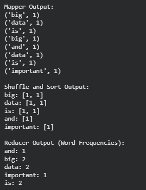

# Exp 02 Word Count using MapReduce

**Date:** 27/10/2026

## AIM:
To implement the Word Count program using the MapReduce programming model and determine the frequency of each word in the given input text.

## DESIGN STEPS:

### Step 1:
Clone the repository from GitHub.

### Step 2:
Create a Python/Java project in the preferred IDE (Eclipse/IntelliJ IDEA/VS Code).

### Step 3:
Create the Python/Java program for the Word Count application using the MapReduce concept.

### Step 4:
Implement the **Mapper** phase to read the input text and emit each word as a key with a value.

### Step 5:
Implement the **Shuffle and Sort** phase to group identical words together.

### Step 6:
Implement the **Reducer** phase to sum the values associated with each word and calculate its total frequency.

### Step 7:
Compile and execute the program.

### Step 8:
Verify and display the word frequencies.

## PROGRAM:

```python
# Name: Santhose Arockiaraj J
# Reg No: 212224230248

# Word Count using MapReduce

text = "big data is big and data is important"

# Mapper phase
def mapper(text):
    intermediate = []

    words = text.lower().split()

    for word in words:
        intermediate.append((word, 1))

    return intermediate


# Shuffle and Sort phase
def shuffle_sort(intermediate):
    grouped = {}

    for word, count in intermediate:
        if word not in grouped:
            grouped[word] = []
        grouped[word].append(count)

    return grouped


# Reducer phase
def reducer(grouped):
    result = {}

    for word, counts in grouped.items():
        result[word] = sum(counts)

    return result


# Execute MapReduce
mapped_data = mapper(text)

print("Mapper Output:")
for item in mapped_data:
    print(item)

grouped_data = shuffle_sort(mapped_data)

print("\nShuffle and Sort Output:")
for word, counts in grouped_data.items():
    print(f"{word}: {counts}")

final_result = reducer(grouped_data)

print("\nReducer Output (Word Frequencies):")
for word, count in sorted(final_result.items()):
    print(f"{word}: {count}")

```

## OUTPUT:


## RESULT:

The Word Count program using the MapReduce programming model was implemented successfully, and the frequency of each word in the given input text was computed correctly.

```
